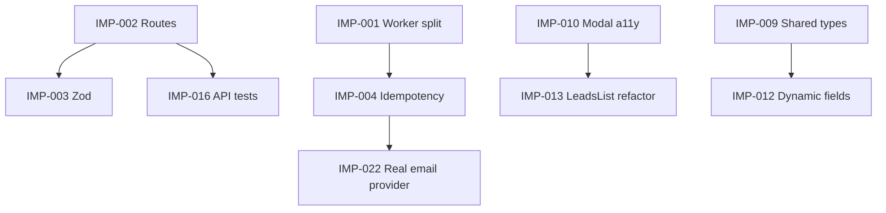

# TinyEnginy — Improvements & Roadmap

> Last updated: 2026-09-14 | Status legend: 🔴 Critical | 🟠 High | 🟡 Medium | 🟢 Low

## Executive Summary

- **Backend runtime risk:** Express API and Temporal worker share a single process; `worker.run()` blocks startup and couples deployment concerns.
- **API surface debt:** Nine endpoints live in a 327-line god file with inconsistent HTTP semantics, ad-hoc validation, and no global error handler.
- **Temporal workflows:** Non-idempotent `workflowId` values and sequential verify-email loops limit reliability and throughput.
- **Frontend maintainability:** `LeadsList.tsx` is monolithic; modals lack a11y; template fields are hardcoded; bulk mutation feedback is incomplete.
- **Production gaps:** No CI, minimal test coverage, no health checks, permissive CORS, and email verification is a stub with artificial delays.

## Roadmap

| Horizon | Focus | Tickets |
|---------|-------|---------|
| **Now** | Backend stability and critical runtime debt | IMP-001, IMP-002, IMP-004, IMP-005 |
| **Next** | Data contracts, API quality, frontend UX | IMP-003, IMP-006–IMP-014 |
| **Later** | CI, tests, production readiness, real providers | IMP-015–IMP-023 |

## Dependency Diagram

---

## Tickets

### IMP-001: Separate Temporal worker from API server

- **Priority:** 🔴 Critical | **Size:** M | **Domain:** Backend / Infrastructure
- **Problem:** Express and the Temporal worker share one process. `runTemporalWorker()` at the end of `backend/src/index.ts` (L321–324) calls blocking `worker.run()`, coupling API availability to worker lifecycle.
- **Proposal:** Add a dedicated `pnpm worker` script; remove `runTemporalWorker()` from `index.ts`; document running two processes in README.
- **Acceptance criteria:**
  - API starts without the worker process.
  - Worker independently processes queue `myQueue`.
  - `POST /leads/verify-emails` continues to enqueue and execute workflows.
- **Branch:** `improve/separate-temporal-worker`
- **Files:** `backend/src/index.ts`, `backend/src/worker.ts`, `backend/package.json`, `README.md`
- **Dependencies:** None

---

### IMP-002: Modularize routes and error middleware

- **Priority:** 🔴 Critical | **Size:** M | **Domain:** Backend / API
- **Problem:** Nine endpoints in a single file; no global error handler; inconsistent HTTP responses (e.g. `GET /leads/:id` returns `null` instead of 404); mixed field naming (`name` vs `firstName`).
- **Proposal:** Extract `src/routes/leads.ts`, `src/middleware/errorHandler.ts`, `src/middleware/validateBody.ts`; unify `name` → `firstName` in POST/PATCH; wrap Prisma calls with consistent try/catch.
- **Acceptance criteria:**
  - External API contract unchanged for existing clients.
  - 404/400/500 responses follow a consistent shape.
  - Prisma errors mapped to appropriate HTTP status codes.
- **Branch:** `improve/backend-route-modularization`
- **Files:** `backend/src/index.ts`, `backend/src/routes/leads.ts`, `backend/src/middleware/errorHandler.ts`, `backend/src/middleware/validateBody.ts`
- **Dependencies:** None

---

### IMP-003: Input validation with Zod

- **Priority:** 🟠 High | **Size:** M | **Domain:** Backend / API
- **Problem:** Ad-hoc validation duplicated across four endpoints; `any` types in bulk error responses (`backend/src/index.ts` L220).
- **Proposal:** Zod schemas per endpoint in `src/schemas/`; reusable validation middleware; typed DTOs for bulk responses.
- **Acceptance criteria:**
  - All write endpoints validated via Zod middleware.
  - Bulk endpoints return typed, structured error arrays.
  - Invalid payloads return 400 with field-level details.
- **Branch:** `improve/api-input-validation`
- **Files:** `backend/src/schemas/`, `backend/src/middleware/validateBody.ts`, `backend/src/routes/leads.ts`
- **Dependencies:** IMP-002

---

### IMP-004: Idempotent and parallel Temporal workflows

- **Priority:** 🔴 Critical | **Size:** M | **Domain:** Backend / Temporal
- **Problem:** `workflowId: verify-email-${lead.id}-${Date.now()}` (L287) prevents idempotency; verify-emails loop is sequential (L283–306), limiting throughput.
- **Proposal:** Deterministic `workflowId` (`verify-email-lead-{id}`); `WorkflowIdReusePolicy`; limited concurrency (e.g. 5) via `Promise.allSettled`.
- **Acceptance criteria:**
  - Re-submitting verify for the same lead does not spawn duplicate workflows.
  - Bulk verify processes leads with bounded concurrency.
  - Existing verify behavior preserved for new leads.
- **Branch:** `improve/temporal-idempotency-parallel`
- **Files:** `backend/src/index.ts`, `backend/src/workflows/workflows.ts`
- **Dependencies:** IMP-001

---

### IMP-005: Environment-based configuration

- **Priority:** 🟠 High | **Size:** S | **Domain:** Backend / DevOps
- **Problem:** Temporal address hardcoded to `localhost:7233`; CORS set to `*`; `.env.sample` references MySQL while `schema.prisma` uses SQLite.
- **Proposal:** Central `src/config.ts` with `PORT`, `TEMPORAL_ADDRESS`, `CORS_ORIGIN`; align `.env.sample`; consume config in worker and Temporal client.
- **Acceptance criteria:**
  - All hardcoded connection values removed from source.
  - `.env.sample` matches actual Prisma provider.
  - Worker and API read from the same config module.
- **Branch:** `improve/env-config`
- **Files:** `backend/src/config.ts`, `backend/.env.sample`, `backend/src/index.ts`, `backend/src/worker.ts`
- **Dependencies:** None

---

### IMP-006: Harden Prisma schema

- **Priority:** 🟠 High | **Size:** M | **Domain:** Backend / Data
- **Problem:** No unique constraint on email; bulk dedup relies on fragile `firstName+lastName` matching; frontend types misaligned (`lastName: string | null` in `frontend/src/api/types/leads/getMany.ts` vs required in DB).
- **Proposal:** Add `@@unique([email])`; optional composite index; migration; align API types on front and back.
- **Acceptance criteria:**
  - Duplicate email inserts rejected at DB level.
  - Frontend Lead types match backend responses.
  - Migration script handles existing duplicates gracefully.
- **Branch:** `improve/prisma-schema-hardening`
- **Files:** `backend/prisma/schema.prisma`, `frontend/src/api/types/leads/`
- **Dependencies:** None
- **Risk:** Migration may fail if duplicate emails exist in `dev.db`.

---

### IMP-007: Country code normalization on import

- **Priority:** 🟡 Medium | **Size:** S | **Domain:** Backend / Data
- **Problem:** Backend accepts `countryCode` without validation (`backend/src/index.ts` L230). Complements the take-home CSV encoding bug (fixed on frontend in `CsvImportModal.tsx`); this ticket covers the API layer.
- **Proposal:** Validate ISO 3166-1 alpha-2 codes; reject or normalize invalid values in bulk import; add unit tests.
- **Acceptance criteria:**
  - Invalid country codes rejected with clear error in bulk response.
  - Valid codes stored in normalized uppercase form.
  - Unit tests cover valid, invalid, and edge cases.
- **Branch:** `improve/country-code-normalization`
- **Files:** `backend/src/index.ts` (or `backend/src/routes/leads.ts` after IMP-002), `backend/src/utils/countryCode.ts`
- **Dependencies:** None

---

### IMP-008: Pagination and filters on GET /leads

- **Priority:** 🟡 Medium | **Size:** M | **Domain:** Backend / API
- **Problem:** `findMany()` without limit (`backend/src/index.ts` L51–55) does not scale.
- **Proposal:** Query params `page`, `limit`, `search`; response shape `{ data, total, page }`; adapt frontend with TanStack Query `keepPreviousData`.
- **Acceptance criteria:**
  - Default page size applied; max limit enforced.
  - Search filters by name/email fields.
  - Frontend table paginates without full reload.
- **Branch:** `improve/leads-pagination`
- **Files:** `backend/src/routes/leads.ts`, `frontend/src/api/modules/leads.ts`, `frontend/src/components/LeadsList.tsx`
- **Dependencies:** IMP-002

---

### IMP-009: Shared API contracts (monorepo)

- **Priority:** 🟡 Medium | **Size:** M | **Domain:** Full-stack / Architecture
- **Problem:** Types duplicated in `frontend/src/api/types/leads/*`; backend types are implicit.
- **Proposal:** `packages/shared` or `shared/types` with Lead, bulk response, and enum definitions; import from both frontend and backend.
- **Acceptance criteria:**
  - Single source of truth for Lead and bulk DTOs.
  - No duplicate type definitions between packages.
  - Build pipeline resolves shared package in both apps.
- **Branch:** `improve/shared-api-types`
- **Files:** `packages/shared/` (new), `frontend/src/api/types/leads/`, `backend/src/types/`
- **Dependencies:** None

---

### IMP-010: Reusable Modal component with a11y

- **Priority:** 🟡 Medium | **Size:** M | **Domain:** Frontend / UX
- **Problem:** Escape handler, body scroll lock, and backdrop logic duplicated in `CsvImportModal.tsx` and `MessageTemplateModal.tsx`; missing `role="dialog"`, focus trap, and `aria-label`.
- **Proposal:** `components/ui/Modal.tsx` with basic a11y; refactor both modals to use it.
- **Acceptance criteria:**
  - Both modals use shared Modal component.
  - Focus trapped inside open modal; Escape closes it.
  - Screen readers announce dialog role and label.
- **Branch:** `improve/shared-modal-a11y`
- **Files:** `frontend/src/components/ui/Modal.tsx`, `frontend/src/components/CsvImportModal.tsx`, `frontend/src/components/MessageTemplateModal.tsx`
- **Dependencies:** None

---

### IMP-011: Improve bulk mutation feedback

- **Priority:** 🟠 High | **Size:** M | **Domain:** Frontend / UX
- **Problem:** Verify email lacks `isPending` (`LeadsList.tsx` L150–151); partial errors ignored (L43–47); delete has no confirmation; error state triggers `window.location.reload()` (L291–307).
- **Proposal:** Loading states, toast with partial success summary, confirm dialog for delete, `refetch()` on error instead of full reload.
- **Acceptance criteria:**
  - All bulk actions show pending/disabled state during execution.
  - Partial failures surfaced with counts (succeeded/failed).
  - Delete requires user confirmation.
  - Errors recover via query refetch, not page reload.
- **Branch:** `improve/bulk-mutation-feedback`
- **Files:** `frontend/src/components/LeadsList.tsx`, `frontend/src/hooks/useLeadsMutations.ts` (new)
- **Dependencies:** None

---

### IMP-012: Dynamic and scalable template fields

- **Priority:** 🟡 Medium | **Size:** M | **Domain:** Frontend / UX
- **Problem:** `availableFields` hardcoded in `MessageTemplateModal.tsx` (L109); does not scale as Lead fields grow.
- **Proposal:** Derive fields from `Lead` type plus metadata (label, group); combobox/search to insert placeholders; extensible via config.
- **Acceptance criteria:**
  - New Lead fields appear automatically in template picker.
  - Placeholder insertion works via search/combobox.
  - Field metadata configurable without code changes for labels.
- **Branch:** `improve/dynamic-template-fields`
- **Files:** `frontend/src/components/MessageTemplateModal.tsx`, `frontend/src/config/templateFields.ts` (new)
- **Dependencies:** IMP-009

---

### IMP-013: Refactor LeadsList and mutation hooks

- **Priority:** 🟡 Medium | **Size:** L | **Domain:** Frontend / Architecture
- **Problem:** `LeadsList.tsx` (~335 lines) mixes fetching, toolbar, table, and dropdown logic.
- **Proposal:** Extract `useLeadsTable`, `LeadsToolbar`, `LeadsTable`; centralize mutations in `hooks/useLeadsMutations.ts`; add click-outside handler for Enrich dropdown.
- **Acceptance criteria:**
  - `LeadsList.tsx` reduced to composition of sub-components.
  - Mutations centralized in a single hook.
  - Enrich dropdown closes on outside click.
  - No behavioral regressions in table or bulk actions.
- **Branch:** `improve/leads-list-refactor`
- **Files:** `frontend/src/components/LeadsList.tsx`, `frontend/src/components/LeadsToolbar.tsx` (new), `frontend/src/components/LeadsTable.tsx` (new), `frontend/src/hooks/useLeadsMutations.ts` (new)
- **Dependencies:** IMP-010, IMP-011

---

### IMP-014: Robust HTTP client

- **Priority:** 🟡 Medium | **Size:** S | **Domain:** Frontend / API
- **Problem:** `frontend/src/utils/axios.ts` has no interceptors, timeout, or error mapping; `MAX_UPLOAD_FILE_SIZE` defined in `frontend/src/api/utils.ts` but unused.
- **Proposal:** Error interceptor mapping `error.response.data` to user messages; request timeout; validate CSV file size on import.
- **Acceptance criteria:**
  - API errors surfaced with meaningful messages.
  - Requests timeout after configurable duration.
  - Oversized CSV uploads rejected before upload.
- **Branch:** `improve/axios-interceptors`
- **Files:** `frontend/src/utils/axios.ts`, `frontend/src/api/utils.ts`, `frontend/src/components/CsvImportModal.tsx`
- **Dependencies:** None

---

### IMP-015: CI with GitHub Actions

- **Priority:** 🟠 High | **Size:** M | **Domain:** DevOps
- **Problem:** No `.github/workflows/`; backend has no lint step.
- **Proposal:** Workflow running `pnpm install`, lint (frontend), test, and build for both packages; cache pnpm store.
- **Acceptance criteria:**
  - CI runs on push/PR to main.
  - Lint, test, and build must pass to merge.
  - pnpm cache reduces install time.
- **Branch:** `improve/ci-pipeline`
- **Files:** `.github/workflows/ci.yml`, `backend/package.json` (add lint script if missing)
- **Dependencies:** None

---

### IMP-016: Backend API tests

- **Priority:** 🟠 High | **Size:** L | **Domain:** Backend / Testing
- **Problem:** Only `backend/src/utils/messageGenerator.test.ts` exists; no API integration tests.
- **Proposal:** supertest + SQLite test DB; cover CRUD, bulk operations, verify-emails (mock Temporal client).
- **Acceptance criteria:**
  - CRUD endpoints tested with happy and error paths.
  - Bulk create/delete/verify covered.
  - Temporal client mocked; no real worker required in CI.
- **Branch:** `improve/backend-api-tests`
- **Files:** `backend/src/__tests__/`, `backend/vitest.config.ts`
- **Dependencies:** IMP-002

---

### IMP-017: Frontend component tests

- **Priority:** 🟡 Medium | **Size:** M | **Domain:** Frontend / Testing
- **Problem:** Only `frontend/src/utils/csvParser.test.ts`; no `@testing-library/react` usage.
- **Proposal:** Tests for LeadsList (loading/error/empty), CsvImportModal preview, MessageTemplateModal placeholders.
- **Acceptance criteria:**
  - LeadsList renders loading, error, and empty states.
  - CsvImportModal shows parsed preview.
  - MessageTemplateModal inserts placeholders correctly.
- **Branch:** `improve/frontend-component-tests`
- **Files:** `frontend/src/components/__tests__/`, `frontend/package.json`
- **Dependencies:** IMP-010 (recommended)

---

### IMP-018: Health checks and graceful shutdown

- **Priority:** 🟡 Medium | **Size:** S | **Domain:** Backend / DevOps
- **Problem:** No `/health` or `/ready` endpoints; Prisma `$disconnect()` not called on shutdown.
- **Proposal:** Add health/readiness endpoints; SIGTERM handler closes Express and disconnects Prisma.
- **Acceptance criteria:**
  - `GET /health` returns 200 when process is alive.
  - `GET /ready` returns 200 when DB connection is available.
  - SIGTERM triggers clean shutdown without orphaned connections.
- **Branch:** `improve/health-graceful-shutdown`
- **Files:** `backend/src/index.ts`, `backend/src/routes/health.ts` (new)
- **Dependencies:** IMP-002 (recommended)

---

### IMP-019: Workflow status API (observability)

- **Priority:** 🟡 Medium | **Size:** M | **Domain:** Backend / Temporal
- **Problem:** Frontend cannot show progress of async enrich/verify operations.
- **Proposal:** `GET /workflows/:workflowId` endpoint; polling from UI; reusable foundation for enrich-phone workflow.
- **Acceptance criteria:**
  - Endpoint returns workflow status (running, completed, failed).
  - UI polls and displays per-lead verification state.
  - Pattern extensible to enrich workflows.
- **Branch:** `improve/workflow-status-api`
- **Files:** `backend/src/routes/workflows.ts` (new), `frontend/src/api/modules/workflows.ts` (new)
- **Dependencies:** IMP-001, IMP-004

---

### IMP-020: Rate limiting and security baseline

- **Priority:** 🟡 Medium | **Size:** M | **Domain:** Backend / Security
- **Problem:** CORS `*`; no rate limiting; bulk delete accepts unlimited ID count.
- **Proposal:** `express-rate-limit`; CORS restricted by env; max ID limit on bulk endpoints; `helmet` for security headers.
- **Acceptance criteria:**
  - Rate limit applied to API routes.
  - CORS origin configurable via env.
  - Bulk endpoints reject payloads exceeding max size.
  - Security headers set via helmet.
- **Branch:** `improve/security-baseline`
- **Files:** `backend/src/index.ts`, `backend/src/config.ts`, `backend/package.json`
- **Dependencies:** IMP-005

---

### IMP-021: Dead code cleanup

- **Priority:** 🟢 Low | **Size:** S | **Domain:** Full-stack / Maintenance
- **Problem:** `@tabler/icons-react` unused; `useApiMutation` not consumed; CRUD endpoints (`getOne/create/update/delete`) have no UI; React Query DevTools shipped in prod (`frontend/src/Providers.tsx` L11).
- **Proposal:** Remove or integrate unused code; render DevTools only when `import.meta.env.DEV`.
- **Acceptance criteria:**
  - Unused dependencies removed from package.json.
  - DevTools not bundled in production build.
  - Orphan hooks/endpoints removed or wired to UI.
- **Branch:** `improve/dead-code-cleanup`
- **Files:** `frontend/package.json`, `frontend/src/Providers.tsx`, `frontend/src/hooks/useApiMutation.ts`
- **Dependencies:** None

---

### IMP-022: Real email verification provider integration

- **Priority:** 🟠 High | **Size:** L | **Domain:** Backend / Integrations
- **Problem:** `verifyEmail` activity is a stub with magic rules (`jane.smith` → 20s sleep) in `backend/src/workflows/activities/utils.ts`.
- **Proposal:** Abstract provider interface (ZeroBounce or similar); Temporal timeouts + heartbeat; replace mock logic.
- **Acceptance criteria:**
  - Provider swappable via config/env.
  - Activity uses heartbeat for long-running checks.
  - Mock stub removed; real API called in non-dev environments.
- **Branch:** `improve/email-verification-provider`
- **Files:** `backend/src/workflows/activities/utils.ts`, `backend/src/providers/emailVerification.ts` (new)
- **Dependencies:** IMP-004

---

### IMP-023: Provider rate-limit preparation for enrich

- **Priority:** 🟢 Low | **Size:** M | **Domain:** Backend / Temporal
- **Problem:** README lists rate-limit handling as nice-to-have; enrich providers have no throttling.
- **Proposal:** Token bucket per provider in activities; Temporal queue with `maxConcurrentActivityExecutionSize`; RPS/RPM config per env.
- **Acceptance criteria:**
  - Provider calls throttled to configured RPS/RPM.
  - Concurrent activity execution bounded.
  - Rate-limit config externalized to env.
- **Branch:** `improve/provider-rate-limiting`
- **Files:** `backend/src/providers/rateLimiter.ts` (new), `backend/src/worker.ts`, `backend/src/config.ts`
- **Dependencies:** IMP-005, IMP-022

---

## Ticket Summary

| ID | Title | Priority | Size | Horizon |
|----|-------|----------|------|---------|
| IMP-001 | Separate Temporal worker from API server | 🔴 Critical | M | Now |
| IMP-002 | Modularize routes and error middleware | 🔴 Critical | M | Now |
| IMP-003 | Input validation with Zod | 🟠 High | M | Next |
| IMP-004 | Idempotent and parallel Temporal workflows | 🔴 Critical | M | Now |
| IMP-005 | Environment-based configuration | 🟠 High | S | Now |
| IMP-006 | Harden Prisma schema | 🟠 High | M | Next |
| IMP-007 | Country code normalization on import | 🟡 Medium | S | Next |
| IMP-008 | Pagination and filters on GET /leads | 🟡 Medium | M | Next |
| IMP-009 | Shared API contracts (monorepo) | 🟡 Medium | M | Next |
| IMP-010 | Reusable Modal component with a11y | 🟡 Medium | M | Next |
| IMP-011 | Improve bulk mutation feedback | 🟠 High | M | Next |
| IMP-012 | Dynamic and scalable template fields | 🟡 Medium | M | Next |
| IMP-013 | Refactor LeadsList and mutation hooks | 🟡 Medium | L | Next |
| IMP-014 | Robust HTTP client | 🟡 Medium | S | Next |
| IMP-015 | CI with GitHub Actions | 🟠 High | M | Later |
| IMP-016 | Backend API tests | 🟠 High | L | Later |
| IMP-017 | Frontend component tests | 🟡 Medium | M | Later |
| IMP-018 | Health checks and graceful shutdown | 🟡 Medium | S | Later |
| IMP-019 | Workflow status API (observability) | 🟡 Medium | M | Later |
| IMP-020 | Rate limiting and security baseline | 🟡 Medium | M | Later |
| IMP-021 | Dead code cleanup | 🟢 Low | S | Later |
| IMP-022 | Real email verification provider | 🟠 High | L | Later |
| IMP-023 | Provider rate-limit preparation | 🟢 Low | M | Later |
